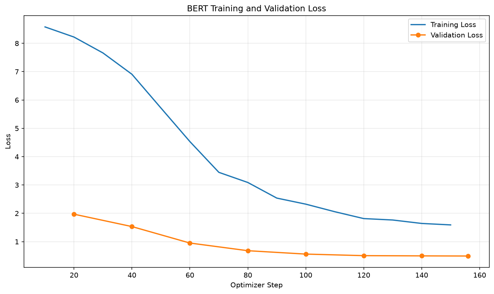
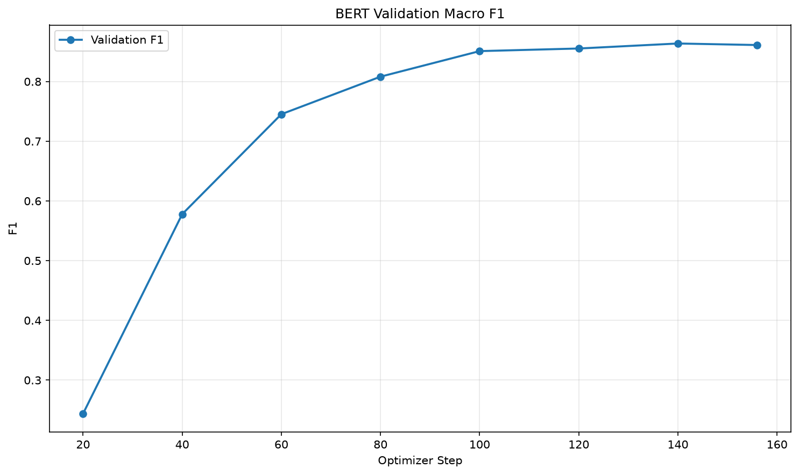

# 中文句子多元情緒分類模型（BERT）

## 訓練資料來源
- [Datasets: Johnson8187/Chinese_Multi-Emotion_Dialogue_Dataset](https://huggingface.co/datasets/Johnson8187/Chinese_Multi-Emotion_Dialogue_Dataset)
- 共 **4,159** 筆繁體中文對話短句，**8** 種情緒標籤：

| 標籤 | 數量 | 佔比 |
| ---- | ----: | ----: |
|平淡語氣|705|16.95%|
|開心語調|592|14.23%|
|關切語調|560|13.46%|
|憤怒語調|527|12.67%|
|驚奇語調|499|12.00%|
|悲傷語調|486|11.69%|
|厭惡語調|404|9.71%|
|疑問語調|386|9.28%|

- 以 `prepare_emotion_data.py` 做出 **80/20 stratified split**：
  - `data/bert_emotion/train.jsonl`: 3,327 筆
  - `data/bert_emotion/valid.jsonl`: 832 筆
  - 每筆格式：`{"sentences": "...", "labels": <整數 0~7>}`

## 基礎模型
- [google-bert/bert-base-chinese](https://huggingface.co/google-bert/bert-base-chinese)
- 加上 8 顆輸出的 `AutoModelForSequenceClassification` 分類頭（`id2label` / `label2id` 附在模型設定中）。

## 訓練環境
- Apple Silicon（Apple M5，Unified Memory），以 **MPS** 後端訓練與推論（FP32）。
- Python 3.12，`.venv` 虛擬環境。

## 安裝套件（python 3.12 / pip list）
- torch 全面版： `2.14.1`（MPS available）
- transformers: `5.17.0`
- datasets: `5.0.1`
- accelerate: `1.15.0`
- scikit-learn: `1.9.0`
- matplotlib: `3.11.1`
- numpy: `2.5.2`
- pandas: `3.0.5`
- pyarrow: `26.0.0`
- huggingface-hub: `1.23.0`

## 訓練超參數
| 設定 | 值 |
| ---- | ---- |
| MAX_SEQ_LENGTH | 128 |
| batch size | 16 × 4 grad accumulation（有效 64） |
| optimizer | AdamW |
| learning rate | 2e-5（linear decay，warmup 50 steps） |
| epochs | 3 |
| eval / save | 每 20 steps |
| early stopping | patience 3（以 eval_loss 為準） |
| 選擇最佳模型 | load_best_model_at_end + eval_loss |

- BERT 訓練裡，我共花費 `222 秒` 在 MPS 裝置上跑完 3 epochs（156 steps）。
- 最佳 checkpoint：`checkpoint-156`（eval_loss 0.4935）。

## 說明
本模型用於判別中文句子的 **8 類情緒語調**：
平淡語氣 / 開心語調 / 關切語調 / 憤怒語調 / 驚奇語調 / 悲傷語調 / 厭惡語調 / 疑問語調。

流程：
1. `prepare_emotion_data.py` 把 Hugging Face 的資料集轉成 jsonl 與 stratified split。
2. `train_bert.py` 用 Dynamic Padding + 設定好的超參數跑 BERT fine-tuning，
   每次驗證都會計算 macro F1 與 accuracy，以 eval_loss 保留最佳模型。
3. `infer_bert.py` 載入最佳模型，對指定的 5 個句子進行預測，
   輸出「句子 => 標籤 (confidence 四位小數)」的格式。

## 作業要求的 5 個 texts 預測結果（實際執行輸出）
```text
我每天都能跟她一起上學，我好開心！ => 開心語調 (0.9486)
最好的朋友要離開臺灣了，以後可能不容易再見面... => 悲傷語調 (0.6960)
我覺得我快不行了... => 悲傷語調 (0.8586)
剛剛收到研究所錄取的通知書！ => 開心語調 (0.9162)
今年的冬天好像比較晚來。 => 平淡語調 (0.8903)
```

## 驗證集表現
| 指標 | 值 |
| ---- | ---- |
| eval_loss（best） | 0.4935 (step 156) |
| macro F1（best） | 0.8637 (step 140) |
| accuracy（best） | 0.8618 (step 140) |

驗證過程記錄（step / eval_loss / macro F1 / accuracy）：
```text
20   1.9700  0.2438  0.3209
40   1.5328  0.5779  0.6226
60   0.9517  0.7453  0.7596
80   0.6811  0.8082  0.8101
100  0.5617  0.8510  0.8510
120  0.5066  0.8553  0.8558
140  0.4987  0.8637  0.8618
156  0.4935  0.8611  0.8594
```

## 執行方法
```bash
# 1. 下載並切分資料
python prepare_emotion_data.py

# 2. Fine-tuning（大約 3~4 分鐘，M5 MPS）
python train_bert.py

# 3. 對指定的 5 個句子預測
python infer_bert.py

# 4. 把 loss 曲線、macro F1 曲線畫成圖
python plot_bert_metrics.py
```

## 成果
- 訓練過程的 loss 曲線與 macro F1 曲線：





## 其它補充
- `prepare_data.py`（二元分類評論的版本）是範例原本的版本，保留供參考；
  作業資料集的版本是 `prepare_emotion_data.py`。
- 模型輸出（`output/bert_emotion_clf/`）包含 best config/safetensors/tokenizer，
  沒有提交 `checkpoint-*` 進 git（.gitignore 已排除）。
- 沒有用 --fp16，因為 MPS 目前不適用 FP16 GradScaler。
